# Federated Intelligence

**A Research-Oriented Federated Learning Platform for Distributed Optimization, Privacy-Preserving Machine Learning, and Experiment Analytics**


Federated Intelligence is a research-oriented platform for experimenting with federated learning under heterogeneous data distributions, communication constraints, client participation changes, and privacy-related configurations.

The project combines a configurable federated learning experimentation pipeline with data validation, experiment tracking, analytical reporting, a FastAPI backend, and a React dashboard.

It is designed to make federated learning experiments easier to configure, execute, inspect, compare, and reproduce.

---

## Table of Contents

- [Overview](#overview)
- [Research and Engineering Scope](#research-and-engineering-scope)
- [System Architecture](#system-architecture)
- [Dashboard](#dashboard)
- [Experimental Analysis](#experimental-analysis)
- [Validated Results](#validated-results)
- [Technology Stack](#technology-stack)
- [Project Structure](#project-structure)
- [Getting Started](#getting-started)
- [Running Experiments](#running-experiments)
- [Generating Reports](#generating-reports)
- [Backend API](#backend-api)
- [Frontend](#frontend)
- [Testing and Code Quality](#testing-and-code-quality)
- [Data and Reproducibility](#data-and-reproducibility)
- [Current Limitations](#current-limitations)
- [Future Work](#future-work)
- [License](#license)

---

## Overview

Federated learning enables multiple clients to collaboratively train machine learning models while keeping their training data local to their respective environments.

However, practical federated learning systems face several challenges:

- **Statistical heterogeneity:** Clients may have different data distributions.
- **Client heterogeneity:** Clients may have different dataset sizes and participation patterns.
- **Communication efficiency:** Repeated model updates can introduce substantial communication overhead.
- **Privacy considerations:** Model updates and training configurations require careful privacy analysis.
- **Unreliable participation:** Clients may become unavailable or fail to complete training rounds.
- **Experiment reproducibility:** Comparing algorithms and configurations requires consistent experiment management and evaluation.

Federated Intelligence provides an experimental environment for investigating these challenges through configurable scenarios, centralized baselines, federated training workflows, and analytical reporting.

### Key capabilities

| Area | Capabilities |
|---|---|
| Federated learning | Configurable federated training experiments |
| Optimization | FedAvg and FedProx experimental configurations |
| Data heterogeneity | IID, label-skew, feature-skew, quantity-skew, and combined non-IID scenarios |
| Client simulation | Client partitioning, participation, and dropout scenarios |
| Privacy experiments | Differential-privacy-related configurations and analysis |
| Communication | Communication-cost tracking and compression-related experiments |
| Distributed execution | Local execution and Ray-based execution paths |
| Experiment management | Experiment configurations, results, and metrics |
| Analytics | Aggregated reports, comparison tables, and research figures |
| Backend | FastAPI endpoints for datasets, experiments, metrics, and analysis |
| Dashboard | React and TypeScript interface for exploring experiment results |

---

## Research and Engineering Scope

### 1. Federated optimization

The platform includes experimental configurations for:

- Federated Averaging (FedAvg)
- Federated Proximal (FedProx)
- Centralized Logistic Regression baseline
- Centralized Multi-Layer Perceptron baseline

The centralized models provide reference points for evaluating federated learning experiments.

### 2. Data heterogeneity

The synthetic data-generation pipeline supports five scenarios:

| Scenario | Description |
|---|---|
| IID | Approximately independent and identically distributed client data |
| Label skew | Different label distributions across clients |
| Feature skew | Differences in feature distributions |
| Quantity skew | Different amounts of data assigned to clients |
| Combined non-IID | A combination of multiple heterogeneity patterns |

### 3. Privacy and communication analysis

The experimental framework includes configurations and analytical outputs related to:

- Privacy budgets and differential privacy
- Clipping and noise configurations
- Communication volume
- Model-update compression
- Client participation
- Network constraints and deadlines

These capabilities provide an experimental basis for studying trade-offs. The presence of a configuration or analytical figure should not be interpreted as proof of a formal privacy guarantee or a measured real-world network deployment.

### 4. Experiment analytics

Experiment outputs can be aggregated into structured tables and figures to support:

- Algorithm comparisons
- Scenario-level analysis
- Seed-level comparisons
- Accuracy and ROC-AUC summaries
- Communication-cost analysis
- Privacy-related analysis
- Experiment monitoring and inspection

---

## System Architecture

The platform separates experiment execution, data management, API services, and dashboard presentation.


### Data flow


The general workflow is:

1. Define an experiment configuration.
2. Select a dataset and client-partitioning scenario.
3. Initialize the federated learning experiment.
4. Execute local client training and server-side aggregation.
5. Record experiment metrics and communication information.
6. Store experiment outputs.
7. Retrieve and compare results through the API and dashboard.

### Federated round lifecycle


The round lifecycle represents the coordination between server-side orchestration, client participation, local training, model aggregation, and evaluation.

---

## Dashboard

The React dashboard provides an interface for exploring experiment configurations and results.

### Overview

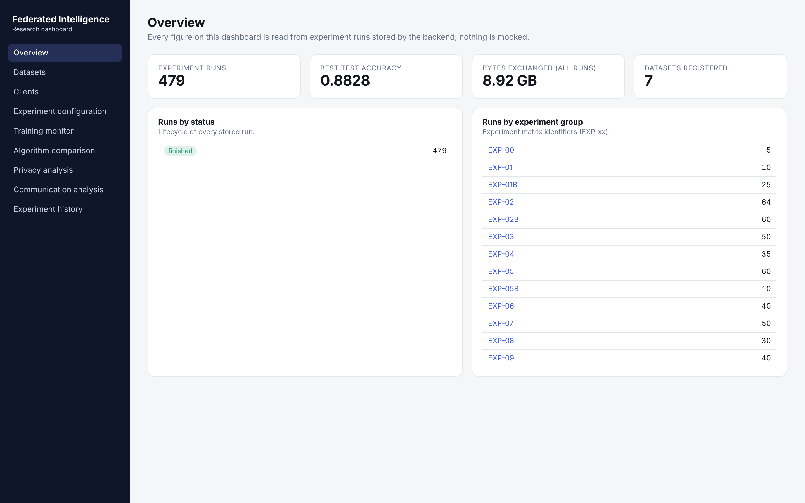

The overview page provides a high-level view of experiment activity and available analytical information.

### Experiment history

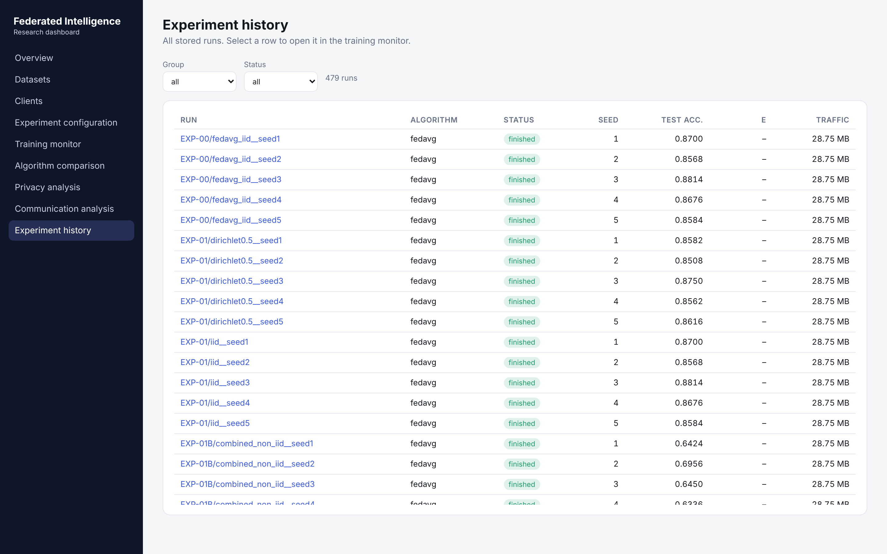

The experiment history interface supports browsing recorded experiments.

### Experiment monitoring

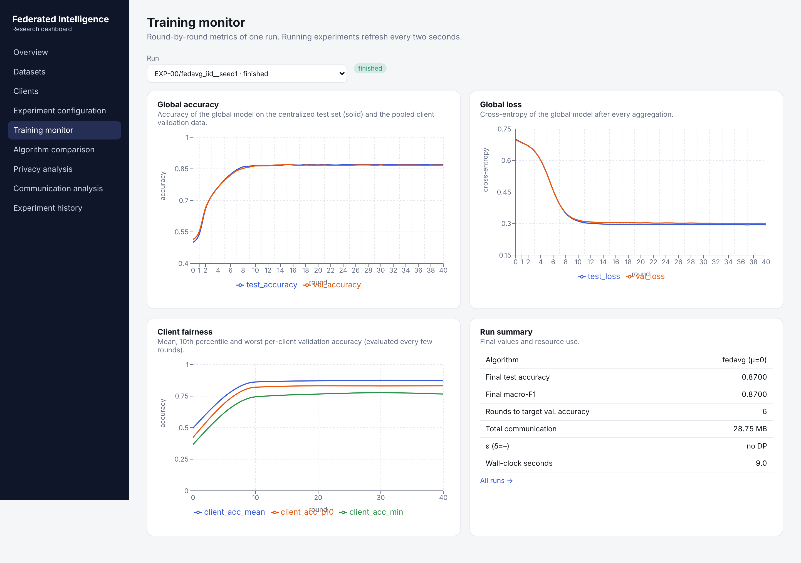

The monitoring interface provides an experiment-level view of execution information.

### Experiment configuration

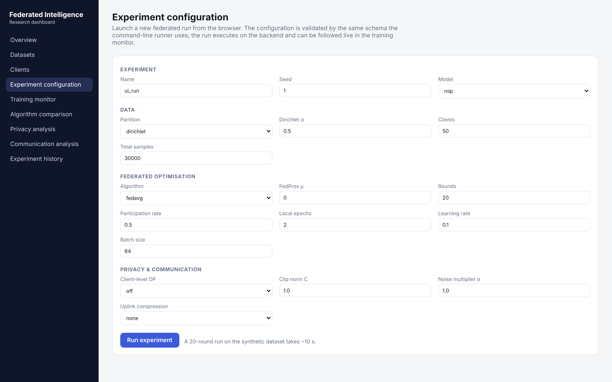

The configuration interface supports working with experiment settings.

### Dataset management

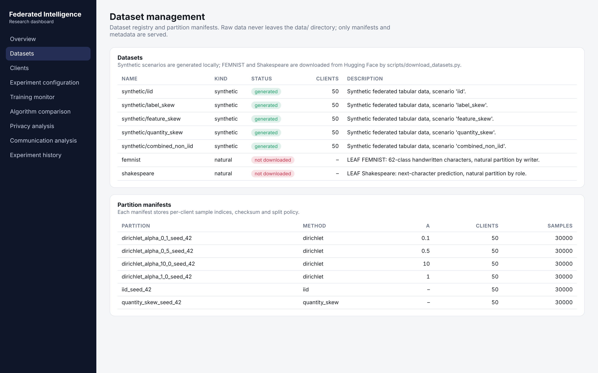

### Client information

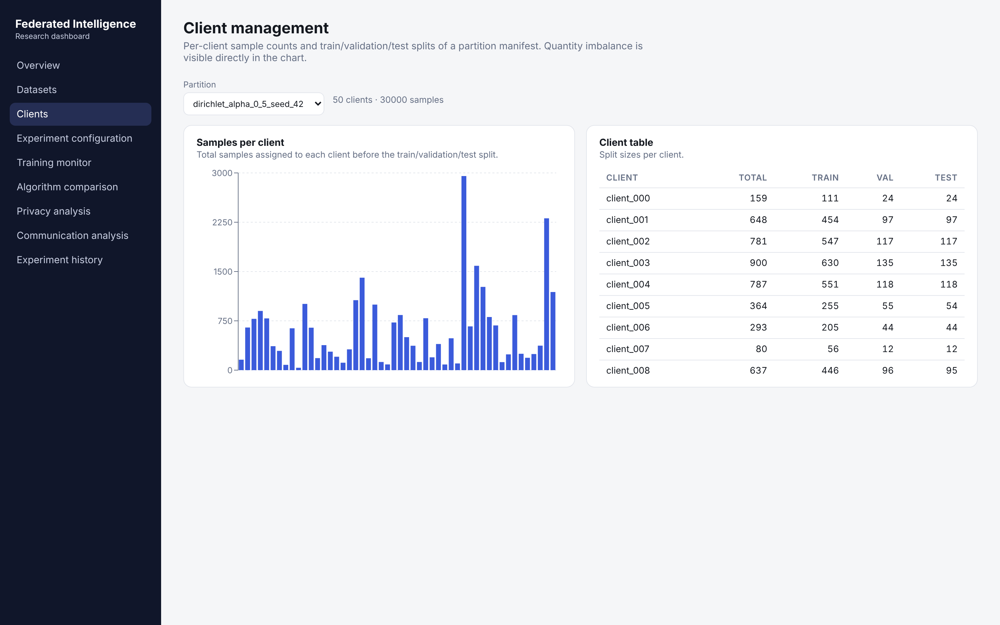

### Algorithm comparison

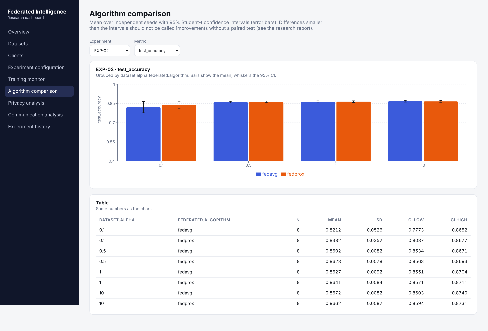

### Privacy analysis

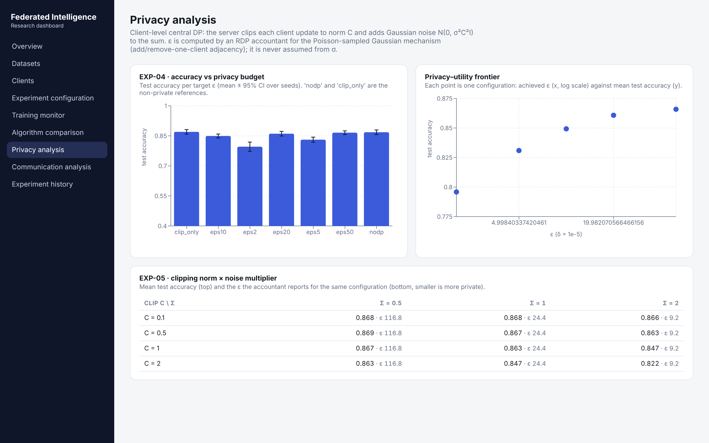

### Communication analysis

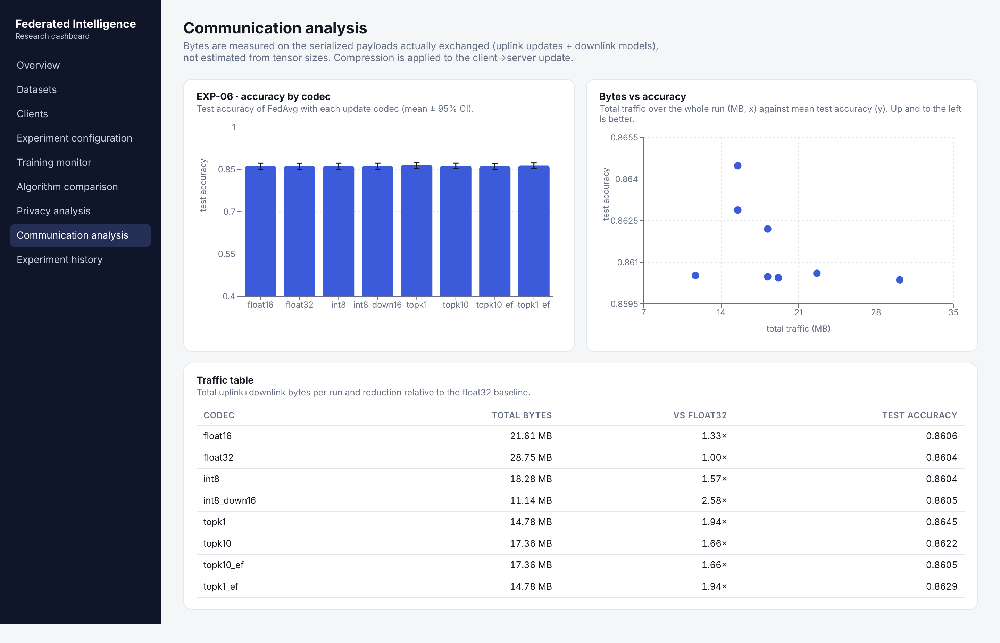

---

## Experimental Analysis

The project includes analytical figures generated from experiment outputs.

### Dataset and client heterogeneity

Client-level data distributions and heterogeneity are important when evaluating federated optimization methods.

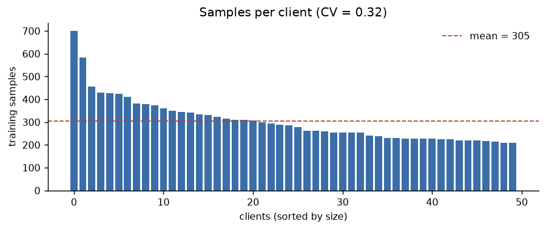


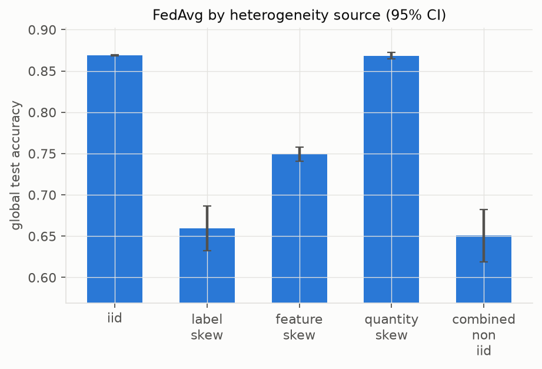

### Optimization and convergence

The following figures support analysis of optimization configurations and convergence behaviour.

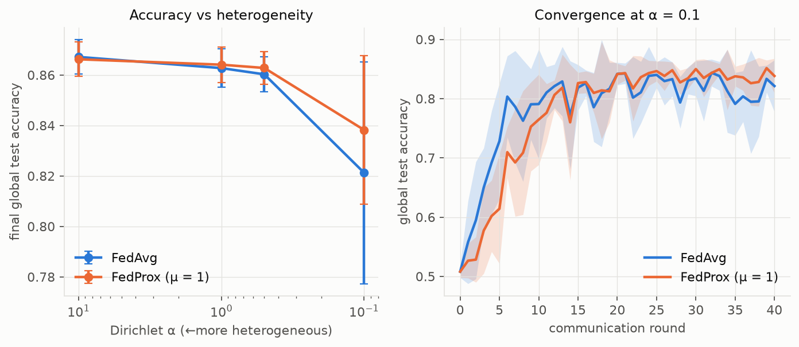


### Privacy-related analysis


### Client participation and reliability


### Communication and network constraints


---

## Validated Results

The following results were obtained from local validation runs and generated project reports.

### Centralized baseline comparison

Five seeds were evaluated for each centralized baseline.

| Model | Test accuracy (mean ± SD) | ROC-AUC (mean ± SD) |
|---|---:|---:|
| Logistic Regression | 0.8697 ± 0.0083 | 0.9467 ± 0.0050 |
| MLP | 0.8576 ± 0.0064 | 0.9405 ± 0.0048 |

These results are baseline measurements for the configured experimental dataset and should not be generalized to other datasets or deployment environments.

### Synthetic data validation

All five supported synthetic scenarios passed the data-validation workflow:

| Scenario | Validation |
|---|---|
| IID | PASS |
| Label skew | PASS |
| Feature skew | PASS |
| Quantity skew | PASS |
| Combined non-IID | PASS |

**Validation summary:** five scenarios passed with zero reported warnings.

### Smoke experiment

A local smoke experiment was executed using:

`configs/experiments/smoke.yaml`

| Metric | Result |
|---|---:|
| Test accuracy | 0.7858 |
| Test loss | 0.51065 |
| Total communication bytes | 105,885 |

This run verifies the configured experiment workflow; it is not intended as a benchmark of model performance.

### Aggregated experiment reports

The report-generation workflow successfully aggregated **479 existing experiment runs** and generated 11 figures and analytical tables.

The 479 runs represent records processed by the report generator, not 479 newly executed experiments during the latest validation session.

---

## Technology Stack

| Layer | Technologies |
|---|---|
| Programming language | Python 3.12–3.13 |
| Machine learning | PyTorch |
| Distributed execution | Ray |
| Backend API | FastAPI, Uvicorn |
| Data processing | Python, NumPy, Pandas |
| Experiment storage | SQLite |
| Frontend | React 18, TypeScript |
| Frontend tooling | Vite, npm |
| Visualization | Recharts and generated analytical figures |
| Testing | Pytest |
| Code quality | Ruff, Mypy |
| Configuration | YAML |
| Container configuration | Docker Compose |

---

## Project Structure

```text
federated-intelligence/
│
├── configs/
│   └── experiments/
│
├── data/
│   ├── interim/
│   ├── metadata/
│   ├── partitions/
│   ├── processed/
│   ├── raw/
│   └── synthetic/
│
├── docker/
│
├── docs/
│   ├── images/
│   │   ├── architecture/
│   │   ├── communication/
│   │   ├── dashboard/
│   │   ├── datasets/
│   │   └── experiments/
│   └── screenshots/
│
├── frontend/
│   ├── src/
│   ├── package.json
│   └── vite.config.ts
│
├── notebooks/
│
├── reports/
│   ├── experiment-results/
│   ├── figures/
│   └── tables/
│
├── scripts/
│   ├── generate_synthetic.py
│   ├── validate_data.py
│   ├── run_experiment.py
│   ├── run_baselines.py
│   └── generate_report.py
│
├── src/
│   └── federated_intelligence/
│       └── api/
│
├── tests/
│
├── .dockerignore
├── .env.example
├── .gitignore
├── docker-compose.yml
├── LICENSE
├── Makefile
├── pyproject.toml
├── README.md
└── requirements-lock.txt
```

The exact contents of generated data, local databases, and report outputs may vary depending on which experiments have been executed.

---

## Getting Started

### Requirements

- Python 3.12 or 3.13
- Node.js 22 or later
- npm
- GitHub repository access
- Windows, Linux, or macOS

The Python project specifies:

`Python >=3.12,<3.14`

### 1. Clone the repository

```bash
git clone https://github.com/YOUR_USERNAME/federated-intelligence.git
cd federated-intelligence
```

Replace `YOUR_USERNAME` with the GitHub account that hosts the repository.

### 2. Create a Python virtual environment

**Windows PowerShell:**

```powershell
py -3.13 -m venv .venv
.\.venv\Scripts\Activate.ps1
```

If Python 3.13 is not available, install a supported Python version first.

### 3. Install Python dependencies

```powershell
python -m pip install --upgrade pip
pip install -e ".[dev]"
```

If you prefer installing from the included lock file, follow the dependency-installation instructions defined for that file and project environment.

### 4. Generate synthetic data

From the project root:

```powershell
python scripts/generate_synthetic.py
```

### 5. Validate data

```powershell
python scripts/validate_data.py
```

### 6. Run a smoke experiment

```powershell
python scripts/run_experiment.py --config configs/experiments/smoke.yaml
```

---

## Running Experiments

Experiment configurations are stored under:

```text
configs/experiments/
```

Run an experiment by specifying its configuration file:

```powershell
python scripts/run_experiment.py --config configs/experiments/smoke.yaml
```

### Run centralized baselines

```powershell
python scripts/run_baselines.py
```

The baseline workflow evaluates the configured centralized models across multiple seeds.

### Generate analytical reports

```powershell
$env:PYTHONUTF8 = "1"
python scripts/generate_report.py
```

Generated report artifacts are stored under:

```text
reports/
├── experiment-results/
├── figures/
└── tables/
```

The tables directory includes aggregated experiment results, paired comparisons, scenario summaries, and a Markdown results summary.

---

## Backend API

The backend is implemented using FastAPI.

### Start the backend

From the project root:

```powershell
$env:PYTHONPATH = (Resolve-Path .\src).Path

python -m uvicorn federated_intelligence.api.main:app `
    --host 127.0.0.1 `
    --port 8000
```

The API is available at:

```text
http://127.0.0.1:8000
```

Interactive API documentation:

```text
http://127.0.0.1:8000/docs
```

### API health check

```powershell
Invoke-RestMethod http://127.0.0.1:8000/api/health
```

### Main endpoints

| Method | Endpoint | Purpose |
|---|---|---|
| GET | `/api/health` | API health status |
| GET | `/api/datasets` | Retrieve dataset information |
| GET | `/api/partitions` | Retrieve client partition information |
| GET | `/api/clients` | Retrieve client information |
| POST | `/api/experiments` | Create an experiment |
| GET | `/api/experiments` | List experiments |
| GET | `/api/experiments/{exp_id}` | Retrieve experiment details |
| GET | `/api/experiments/{exp_id}/metrics` | Retrieve experiment metrics |
| GET | `/api/experiments/{exp_id}/rounds` | Retrieve round-level information |
| GET | `/api/overview` | Retrieve dashboard overview |
| GET | `/api/analysis/compare` | Compare experiment results |
| GET | `/api/analysis/groups` | Retrieve experiment groups |

The interactive Swagger interface provides the available request and response schemas.

### API documentation screenshot

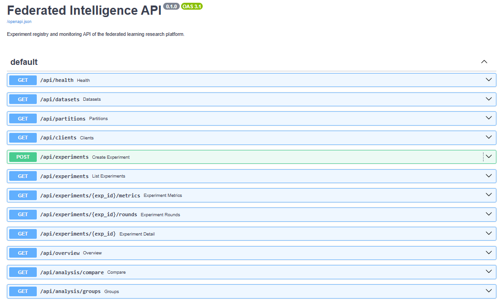

---

## Frontend

The frontend is built with React, TypeScript, and Vite.

### Install dependencies

```powershell
cd frontend
npm ci
```

### Start development server

```powershell
npm run dev
```

The Vite development server uses:

```text
http://localhost:5173
```

The development configuration proxies `/api` requests to the backend at:

```text
http://localhost:8000
```

### Build for production

```powershell
npm run build
```

The production build is generated in:

```text
frontend/dist/
```

The FastAPI application is configured to serve the frontend build when the distribution directory is present.

---

## Testing and Code Quality

The project uses Pytest for automated testing, Ruff for linting, and Mypy for static type checking.

### Ruff

```powershell
python -m ruff check src tests
```

**Validated result:** All checks passed.

### Mypy

```powershell
python -m mypy src
```

**Validated result:** No issues found in 84 source files.

### Standard tests

```powershell
python -m pytest --ignore=tests/performance/test_performance.py -m "not ray" -v
```

**Validated result:** 119 passed, 2 deselected.

### Ray tests

```powershell
python -m pytest --ignore=tests/performance/test_performance.py -m ray -v
```

**Validated result:** 2 passed, 119 deselected.

**Combined validation:** 121 selected tests passed across the standard and Ray test runs.

The performance test file was excluded from these Windows runs because it imports the Unix-specific `resource` module, which is unavailable in the Windows environment used for validation. Therefore, these results should not be interpreted as a complete execution of every test file.

### Frontend production build

```powershell
cd frontend
npm ci
npm run build
```

**Validated result:** Vite successfully generated the production build.

---

## Data and Reproducibility

The project distinguishes between source datasets, generated synthetic data, intermediate processing outputs, client partitions, and experiment results.

### Data categories

| Directory | Purpose |
|---|---|
| `data/raw/` | Original source datasets |
| `data/interim/` | Intermediate processing outputs |
| `data/processed/` | Processed datasets |
| `data/metadata/` | Dataset and experiment metadata |
| `data/partitions/` | Client-level data partitions |
| `data/synthetic/` | Generated synthetic datasets |

### Reproducibility considerations

- Experiment configurations are stored as YAML files.
- Synthetic scenarios can be generated through project scripts.
- Experiment results are stored for later inspection.
- Multiple random seeds are used in baseline evaluation.
- Analytical tables and figures are generated from recorded experiment outputs.
- Automated tests validate selected execution and data-processing workflows.

Actual source datasets may require separate downloading and preparation. Their availability is not implied by the presence of dataset metadata or validation code.

---

## Current Limitations

This project is an experimental research and engineering platform. Its current results should be interpreted within the following limitations:

1. **Synthetic data:** The validated synthetic scenarios do not establish performance on real-world federated datasets.
2. **External datasets:** FEMNIST and Shakespeare were not downloaded during the reported data-validation run.
3. **Network simulation:** Network constraints are studied through configured experimental scenarios rather than a validated deployment across geographically distributed devices.
4. **Privacy guarantees:** Differential-privacy-related experiments and configurations should not be interpreted as a formal end-to-end privacy certification.
5. **Storage:** SQLite was used for local API validation; this does not establish production-scale database performance.
6. **Windows testing:** The performance test module requiring the Unix `resource` package was not included in the reported Windows test runs.
7. **Deployment:** The presence of Docker configuration files does not imply that a complete containerized production deployment has been validated.

---

## Future Work

Potential extensions include:

- Evaluation on additional real-world federated datasets.
- More extensive comparisons of federated optimization algorithms.
- Further investigation of non-IID client distributions.
- More rigorous privacy accounting and privacy-utility evaluation.
- Improved communication-efficiency experiments.
- Evaluation under more realistic client availability and network conditions.
- Scalable experiment storage and deployment.
- Extended distributed execution and monitoring capabilities.

These are potential research and engineering directions, not claims of completed functionality.

---

## License

This project is distributed under the MIT License. See [`LICENSE`](LICENSE) for details.

---

**Federated Intelligence**  
*A research-oriented platform for federated learning, distributed experimentation, and analytical evaluation.*
