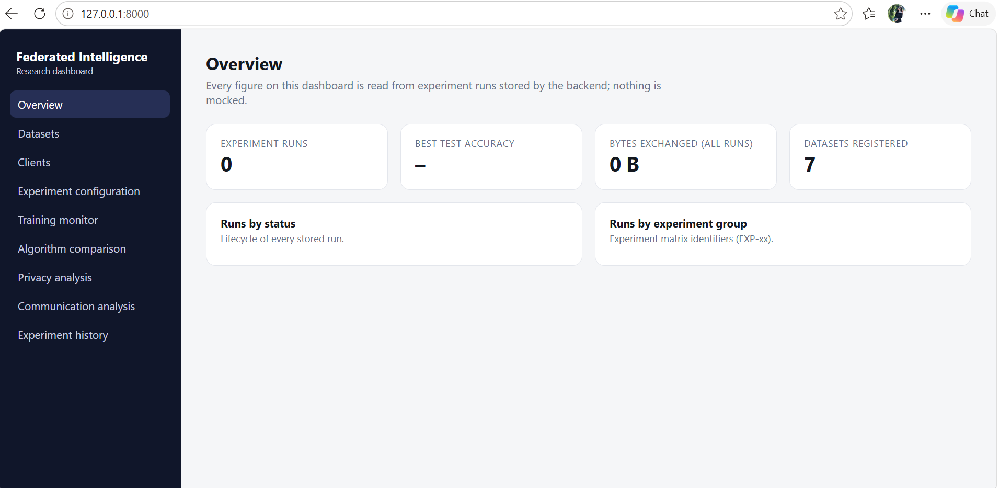
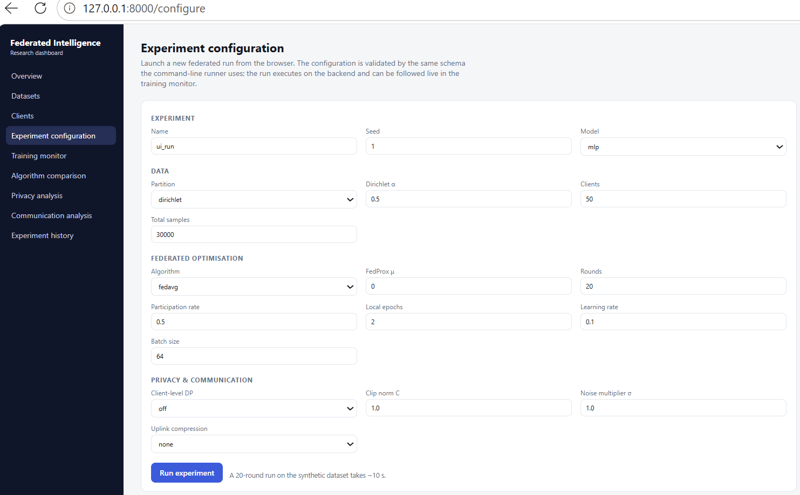
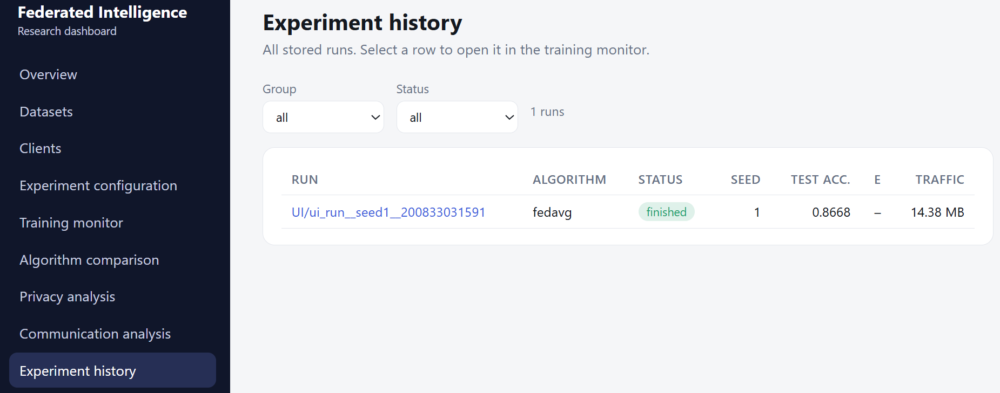
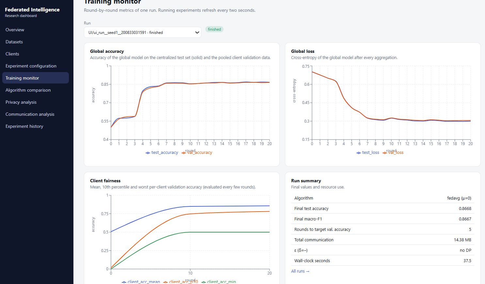
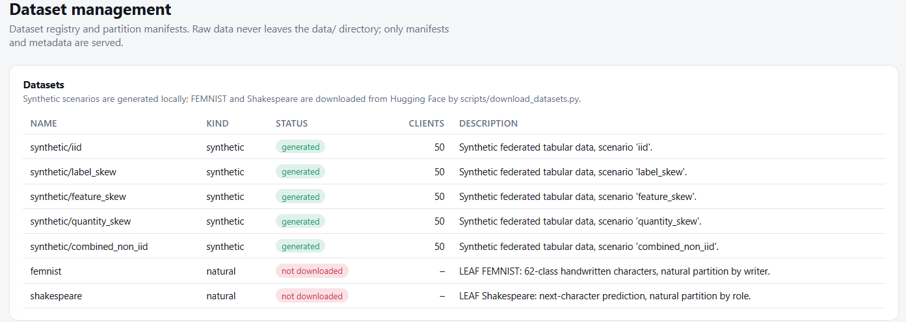
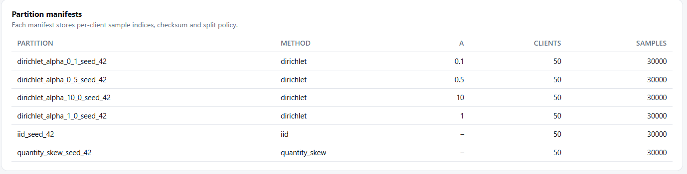
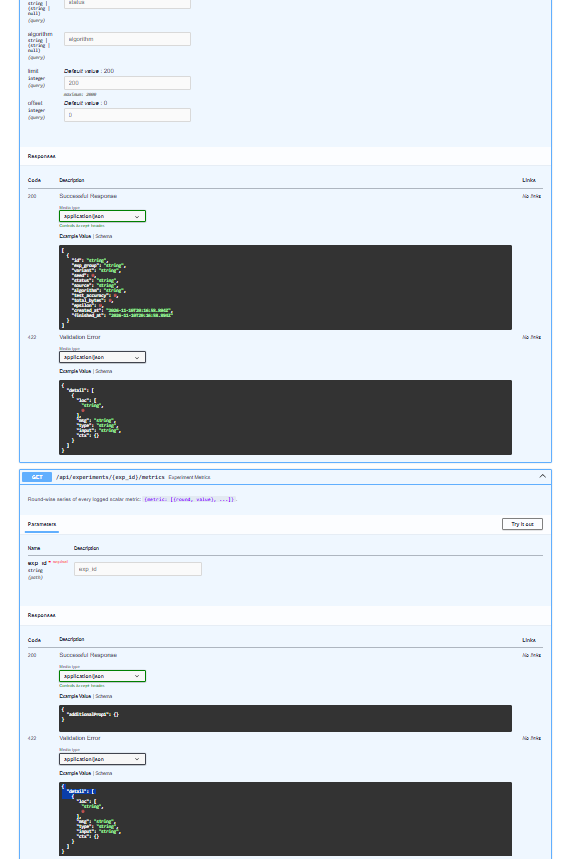
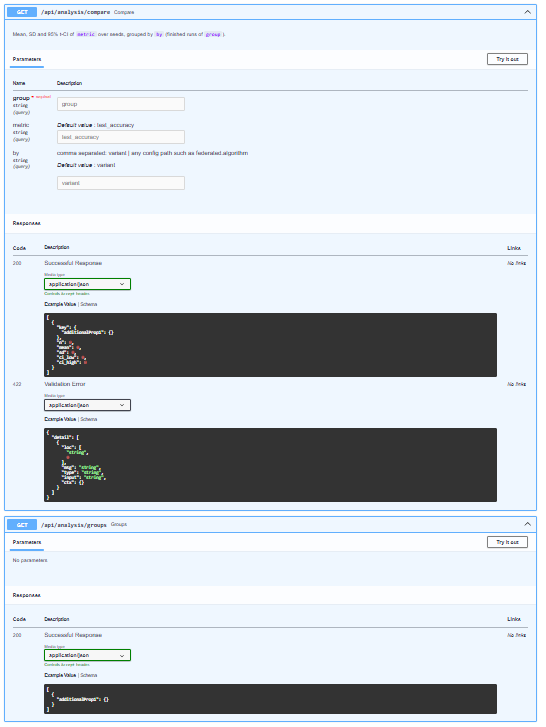
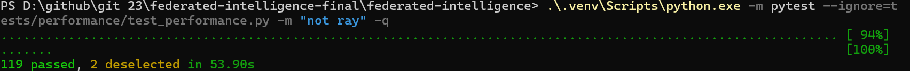
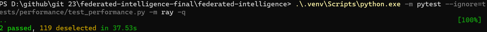

# Federated Intelligence

**A Research-Oriented Federated Learning Platform for Distributed Optimization, Privacy-Preserving Machine Learning, Client Heterogeneity, and Communication-Efficient Training.**

Federated Intelligence is a custom-built research and experimentation platform for studying federated learning systems. It brings together synthetic data generation, client partitioning, federated optimization, privacy mechanisms, communication simulation, experiment tracking, statistical analysis, and an interactive web dashboard.

The project is designed to make federated learning experiments reproducible, inspectable, and measurable — from data preparation and client selection to model aggregation and result analysis.

---

## Project at a Glance

| Component | Technology |
|---|---|
| Core ML | Python, PyTorch, NumPy, scikit-learn |
| Federated learning | FedAvg, FedProx, client/server orchestration |
| Distributed execution | Local executor, Ray |
| Privacy | Differential privacy, gradient/update clipping, Gaussian noise, RDP accounting |
| Communication | Float16, int8, top-k compression, network simulation |
| Data engineering | Synthetic data generation, partitioning, validation, Parquet |
| Experiment management | YAML configurations, multi-seed experiments, JSON/MLflow tracking |
| Backend | FastAPI, SQLAlchemy, SQLite |
| Frontend | React, TypeScript, Vite, Recharts |
| Testing and quality | Pytest, Ruff, Mypy |
| Deployment infrastructure | Docker Compose, GitHub Actions |

## System Overview

The platform follows an experiment-driven architecture:

1. Experiment configurations define datasets, models, algorithms, privacy settings, communication strategies, and execution backends.
2. The experiment runner coordinates client selection and distributed local training.
3. Clients return model updates to the central coordinator.
4. The coordinator validates and aggregates updates, with optional privacy and communication mechanisms.
5. Experiment results are persisted and made available through a FastAPI backend.
6. The React dashboard provides an interface for inspecting experiments, datasets, training metrics, and analysis.



*Figure 1. Dashboard overview showing the platform's experiment-level summary.*

## Research and Engineering Capabilities

| Research area | Implemented capabilities |
|---|---|
| Data heterogeneity | IID and non-IID data generation, label skew, feature skew, quantity skew, and combined scenarios |
| Data validation | Dataset and partition validation, quality checks, and consistency checks |
| Federated optimization | Client/server workflow, FedAvg, FedProx, and configurable client participation |
| Distributed execution | Local reference executor and Ray-based execution |
| Privacy mechanisms | Update clipping, Gaussian noise, privacy-budget configuration, and RDP accounting |
| Communication efficiency | Float16 and int8 quantization, top-k sparsification, and communication-cost tracking |
| Network simulation | Configurable communication conditions and client availability |
| Experiment management | YAML-driven configurations, multi-seed runs, result persistence, and report generation |
| Statistical evaluation | Aggregated experiment results, paired comparisons, confidence intervals, and statistical analysis |
| Interactive application | FastAPI backend and React/TypeScript dashboard |

## Experimental Results

### Experiment coverage

The generated research report aggregates **479 experiment runs**. These results cover the synthetic federated tabular benchmark and the experiment configurations available in the repository.

The synthetic data pipeline supports the following scenarios:

- IID
- Label skew
- Feature skew
- Quantity skew
- Combined non-IID

All five synthetic scenarios passed the data-validation checks during the local validation run, with zero reported warnings.

**Dataset scope and reproducibility note:** The reported experimental results are from the synthetic benchmark. FEMNIST and Shakespeare pipelines are included in the project, but the real datasets were not downloaded during development. Therefore, this README does not claim experimental results on those real datasets.

### Centralized baseline comparison

The centralized baseline script was executed across five seeds for each model.

| Model | Mean test accuracy | Standard deviation | Mean ROC-AUC | ROC-AUC SD |
|---|---:|---:|---:|---:|
| Logistic Regression | 0.8697 | 0.0083 | 0.9467 | 0.0050 |
| MLP | 0.8576 | 0.0064 | 0.9405 | 0.0048 |

These measurements provide centralized reference points for interpreting the federated experiments. They should not be interpreted as evidence that one model will perform better across all datasets or partitioning conditions.

### Federated smoke experiment

A local smoke experiment was executed using the repository's smoke configuration.

| Metric | Result |
|---|---:|
| Experiment | `smoke_fedavg` |
| Seed | 1 |
| Test accuracy | 0.7858 |
| Test loss | 0.51065 |
| Total communication bytes | 105,885 |

This run verifies the basic experiment execution and result-generation workflow. It is a smoke test, not a substitute for the full experimental evaluation.

### Generated research outputs

The report-generation workflow successfully processed the available experiment records and generated:

- 11 figures
- Aggregated experiment tables
- CSV result summaries
- Data-quality report
- Statistical comparison outputs
- A consolidated Markdown results summary

The generated outputs are available in:

- `reports/figures/`
- `reports/tables/`
- `reports/tables/results_summary.md`

## Dashboard

The dashboard connects to the FastAPI backend and presents experiment information through an interactive interface.

### Experiment registry



*Figure 2. Experiment registry showing stored experiment records and their status.*

### Experiment details



*Figure 3. Experiment detail view for inspecting an individual experiment.*

### Training metrics



*Figure 4. Training metrics interface for examining model performance during federated training.*

### Dataset management



*Figure 5. Dataset overview showing the datasets registered in the platform.*

### Client data partitions



*Figure 6. Client partition information for inspecting federated data distribution.*

## API

The FastAPI backend exposes endpoints for health checks, dataset and partition information, client information, experiment management, metrics, and statistical analysis.

| Endpoint | Purpose |
|---|---|
| `GET /api/health` | Backend health and database status |
| `GET /api/overview` | Experiment-level summary |
| `GET /api/datasets` | Registered dataset information |
| `GET /api/partitions` | Client partition information |
| `GET /api/clients` | Client information |
| `POST /api/experiments` | Create an experiment record |
| `GET /api/experiments` | Retrieve experiment records |
| `GET /api/experiments/{exp_id}` | Retrieve an individual experiment |
| `GET /api/experiments/{exp_id}/metrics` | Retrieve experiment metrics |
| `GET /api/experiments/{exp_id}/rounds` | Retrieve round-level results |
| `GET /api/analysis/groups` | Retrieve available analysis groups |
| `GET /api/analysis/compare` | Compare experiment groups |

Interactive API documentation is available at `/docs` when the backend is running.


*Figure 7. FastAPI interactive documentation.*



*Figure 8. Experiment API endpoint documentation.*



*Figure 9. Analysis API endpoint documentation.*

## Installation

### Requirements

- Python 3.12 or 3.13
- Node.js and npm
- Git
- Optional: Docker Desktop for container-based workflows
- Optional: Ray for distributed execution

### Set up the Python environment

```bash
git clone <your-repository-url>
cd federated-intelligence

python -m venv .venv

# Windows PowerShell
.venv\Scripts\Activate.ps1

# Linux / macOS
source .venv/bin/activate

python -m pip install --upgrade pip
pip install -e ".[dev,api,privacy,tracking,distributed]"

python -m pip check
```

### Set up the frontend

```bash
cd frontend
npm ci
npm run build
```

## Quickstart

Run the following commands from the repository root with the Python environment activated.

### 1. Generate synthetic datasets

```bash
python scripts/generate_synthetic.py
```

### 2. Validate datasets and partitions

```bash
python scripts/validate_data.py
```

### 3. Run a smoke experiment

```bash
python scripts/run_experiment.py --config configs/experiments/smoke.yaml
```

### 4. Run centralized baselines

```bash
python scripts/run_baselines.py
```

### 5. Generate research reports

```bash
python scripts/generate_report.py
```

### 6. Start the API

```bash
# Windows PowerShell
$env:PYTHONPATH = (Resolve-Path .\src).Path
python -m uvicorn federated_intelligence.api.main:app --host 127.0.0.1 --port 8000
```

Open the following addresses:

- Dashboard: `http://127.0.0.1:8000/`
- API documentation: `http://127.0.0.1:8000/docs`
- Health endpoint: `http://127.0.0.1:8000/api/health`

The dashboard is served by the backend when the frontend production build is available in `frontend/dist`.

## Distributed Execution

The project includes a local reference execution backend and a Ray-based executor.

The Ray tests verify that the Ray executor produces results consistent with the local executor for the same seed, and that timeout handling produces the expected status.

Ray can be installed through the project's distributed dependency group:

```bash
pip install -e ".[distributed]"
```

## Testing and Code Quality

The project was validated locally on Windows.

| Validation | Result |
|---|---|
| Ruff | All checks passed |
| Mypy | No issues found in 84 source files |
| Synthetic data validation | All five scenarios passed; zero warnings |
| Frontend production build | Passed |
| API health check | Passed; SQLite database detected |
| Standard test selection | 119 passed, 2 deselected |
| Ray test selection | 2 passed, 119 deselected |
| Combined selected test coverage | **121 tests passed** |

The test suite was run in two selections:

```bash
python -m pytest --ignore=tests/performance/test_performance.py -m "not ray" -v

python -m pytest --ignore=tests/performance/test_performance.py -m ray -v
```

**Platform-specific testing note:** `tests/performance/test_performance.py` was excluded from these runs because it imports Python's Unix-specific `resource` module, which is unavailable in the Windows environment used for validation. Performance tests are therefore not claimed as passed.



*Figure 10. Standard test selection: 119 passed, 2 deselected.*



*Figure 11. Ray test selection: 2 passed, 119 deselected.*

## Repository Structure

```text
federated-intelligence/
├── configs/
│   └── experiments/
├── data/
├── docker/
├── docs/
│   └── screenshots/
├── frontend/
├── notebooks/
├── reports/
│   ├── experiment-results/
│   ├── figures/
│   └── tables/
├── scripts/
├── src/
│   └── federated_intelligence/
├── tests/
├── .github/
├── docker-compose.yml
├── pyproject.toml
└── README.md
```

## Current Limitations

- Reported experiments use synthetic federated tabular data; real FEMNIST and Shakespeare results are not yet available.
- Synthetic data cannot represent all characteristics of real-world federated datasets.
- Results based on a limited number of independent seeds should be interpreted cautiously.
- Network conditions are simulated rather than measured from a real distributed deployment.
- Client-level central differential privacy assumes a trusted aggregation server; it is not record-level differential privacy.
- The local API health check was verified with SQLite. PostgreSQL deployment should be validated separately before making production-readiness claims.
- Performance tests requiring the Unix `resource` module were not executed in the Windows validation environment.

## Research Outputs and Documentation

Further technical details and experimental evidence are available in:

- `reports/tables/results_summary.md` — aggregated experiment results.
- `reports/tables/` — CSV tables and statistical outputs.
- `reports/figures/` — generated experiment figures.
- `docs/screenshots/` — dashboard, API, and test evidence.
- `configs/experiments/` — experiment configurations.

## License

This project is distributed under the MIT License. See [LICENSE](LICENSE) for details.

Third-party datasets and libraries remain subject to their respective licences and terms of use.
