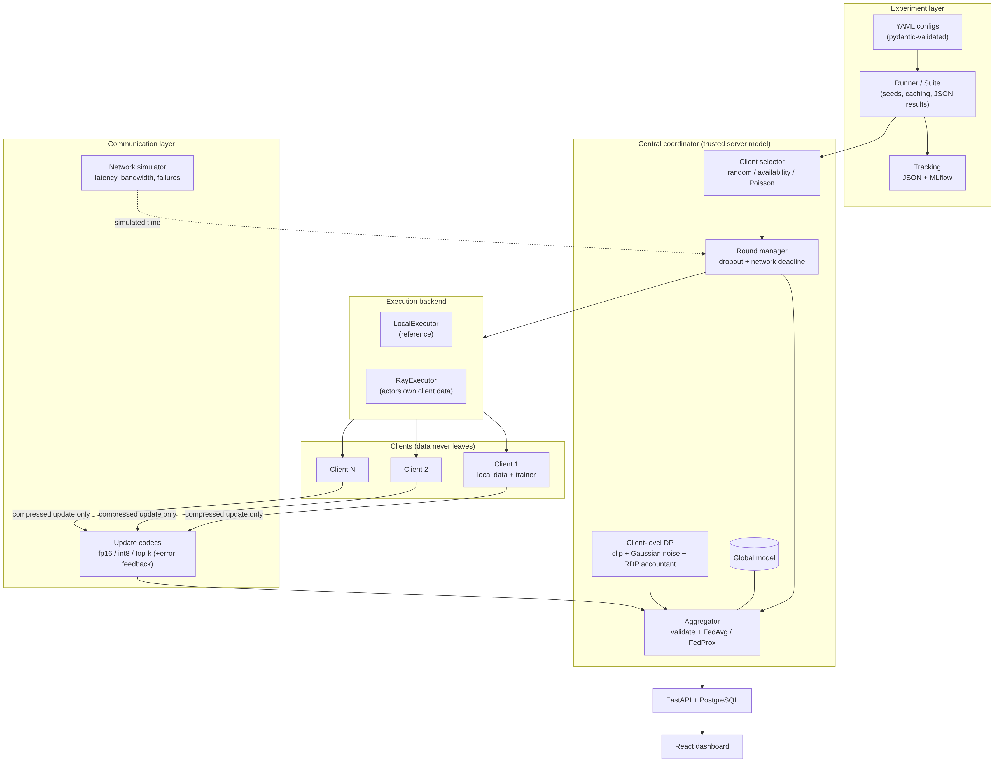
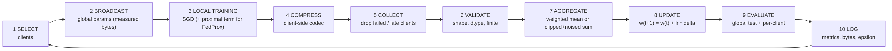
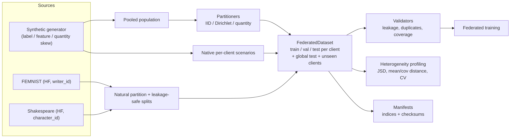

# Architecture

*Figure 1 – System architecture. The experiment layer (YAML → runner → tracking) drives a central coordinator. The coordinator selects clients, hands tasks to an execution backend (in-process or Ray), and only ever receives compressed model updates, which pass through validation, optional client-level DP, and aggregation. Results flow to the FastAPI/PostgreSQL backend and the React dashboard.*

*Figure 2 – One federated round. Clients that fail, drop out or miss the network deadline are excluded from the round; their update is never replaced by zeros and aggregation weights are re-normalised over the survivors.*

*Figure 3 – Data flow. Synthetic data (native per-client scenarios or a pooled population run through the partitioners) and natural FEMNIST/Shakespeare partitions all end in the same `FederatedDataset` container, which is validated, profiled and described by checksummed manifests before training.*

## Module map

| Package | Responsibility |
|---|---|
| `data/generators` | Controllable synthetic federated tabular data (label, feature, quantity skew, label noise) |
| `data/partitioners` | IID, Dirichlet label skew, log-normal quantity skew, natural (by group id), manifests |
| `data/loaders` | Synthetic read-back with checksum verification; FEMNIST and Shakespeare loaders with leakage-safe splits |
| `data/validators`, `data/profiling` | Quality / leakage checks; JSD, mean/covariance distance, sample CV, figures |
| `models/` | Logistic regression, MLP, FEMNIST CNN, character GRU; NumPy ⇄ torch parameter helpers |
| `clients/` | Client (owns data, returns updates only), local trainer (SGD + FedProx term), registry (metadata only) |
| `server/` | Coordinator, round manager (selection, dropout, deadlines), aggregator (validation + weighted mean) |
| `algorithms/` | FedAvg, FedProx strategies |
| `privacy/` | L2 clipping, Gaussian noise, RDP accountant for the sampled Gaussian mechanism, DP aggregator |
| `communication/` | float16 / int8 / top-k codecs with optional error feedback, measured payload sizes, network simulator |
| `orchestration/` | `LocalExecutor` (reference) and `RayExecutor` (actors own client data, timeouts, failure handling) |
| `experiments/` | Pydantic configuration, runner, suites (grid × seeds, resumable), tracking (JSON / MLflow), reproducibility metadata |
| `evaluation/` | Metrics, convergence statistics, centralized baselines, statistical tests |
| `api/` | FastAPI app, SQLAlchemy models (SQLite / PostgreSQL), result importer |

## Design decisions

* **Local simulation is the reference.** Ray is an additional backend; both use per-(round, client) derived seeds so a client's update does not depend on execution order, and a test asserts local ≡ Ray.
* **Clients return updates, not data.** `ClientResult` has no data fields; the coordinator only knows client ids and sample counts.
* **Measured, not estimated, bytes.** Every payload is serialized and its byte length recorded; simulated network time is reported separately from wall-clock time.
* **No hard-coded hyper-parameters.** Everything is configuration; suites expand variants × seeds into independent, cached run files.
