# Federated Intelligence – Technical Research Report

*A custom-built federated learning research platform: heterogeneity, FedProx, client-level differential privacy, communication compression and client availability.*

> **Scope and honesty statement.** Every number in this report is read from the experiment result files in `reports/experiment-results/` (479 runs) and the tables in `reports/tables/`, produced by `scripts/generate_report.py`. All quantitative findings are on the **synthetic federated tabular** benchmark. The FEMNIST and Shakespeare pipelines (downloaders, loaders, CNN, GRU, leakage-safe splits, configs) are implemented and tested on schema-identical fixtures, but the real datasets could not be downloaded in the development sandbox (huggingface.co was blocked), so **no FEMNIST or Shakespeare results are claimed**.

## 1. Abstract

We built a federated learning (FL) research platform from first principles: a controllable synthetic data generator, custom partitioners, a client/server engine with FedAvg and FedProx, client-level central differential privacy (DP) with a self-implemented Rényi-DP accountant validated against Opacus, real-payload communication compression, a network simulator, a Ray execution backend, a config-driven experiment framework, a FastAPI + React monitoring stack and a test/CI pipeline. Using 479 runs (5–8 independent seeds per condition, paired designs, Holm correction), we find that (i) label and feature skew in the data-generating process cost 21 and 12 accuracy points respectively, whereas quantity skew costs nothing measurable; (ii) a Dirichlet(0.5) partition of a pooled population lowers mean accuracy by only 0.65 points (not significant, n = 5) but cuts worst-client accuracy from 0.79 to 0.56; (iii) FedProx (μ = 1) does not yield a statistically robust accuracy gain and converges more slowly; (iv) client-level DP with ε ≤ 10 (δ = 1e-5, 50 clients) costs 2–7 accuracy points, and more clients help; (v) 8-bit quantization cuts uplink bytes 3.7× at no measurable accuracy loss, and top-1 % sparsification 41× at a small convergence-speed cost; (vi) up to 50 % random client dropout is nearly harmless, 70 % is not.

## 2. Introduction

Federated learning trains a shared model across clients that keep their data locally. Practical deployments face statistical heterogeneity, privacy requirements, scarce bandwidth and unreliable participation. Most public work uses off-the-shelf frameworks; this project instead implements the core components itself so that each design decision (what is clipped, what is counted as a byte, which clients are aggregated) is explicit and testable.

## 3. Research objectives and questions

| ID | Question | Experiments |
|---|---|---|
| RQ1 | How does non-IID data affect convergence and predictive performance? | EXP-01, EXP-01B |
| RQ2 | Does FedProx improve over FedAvg under heterogeneity? | EXP-02, EXP-02B, EXP-08 |
| RQ3 | How does differential privacy affect utility? | EXP-04, EXP-05, EXP-05B, EXP-08 |
| RQ4 | How much does compression save and what does it cost? | EXP-06, EXP-09 |
| RQ5 | How do participation, dropout and network latency affect training? | EXP-03, EXP-07, EXP-09 |

## 4. Background and related work

FedAvg (McMahan et al., 2017) averages locally trained models weighted by sample counts. Label-skew partitioning with a Dirichlet prior follows Hsu et al. (2019). FedProx (Li et al., 2020) adds a proximal term to limit client drift. Client-level DP for federated training follows McMahan et al. (2018) with Rényi-DP accounting of the sampled Gaussian mechanism (Mironov, 2019; Mironov et al., 2019) and the improved RDP→(ε, δ) conversion of Balle et al. (2020). The LEAF benchmark (Caldas et al., 2018) provides FEMNIST and Shakespeare. Top-k sparsification with error feedback and quantization follow the gradient-compression literature (e.g. Stich et al., 2018; Alistarh et al., 2017).

## 5. System architecture

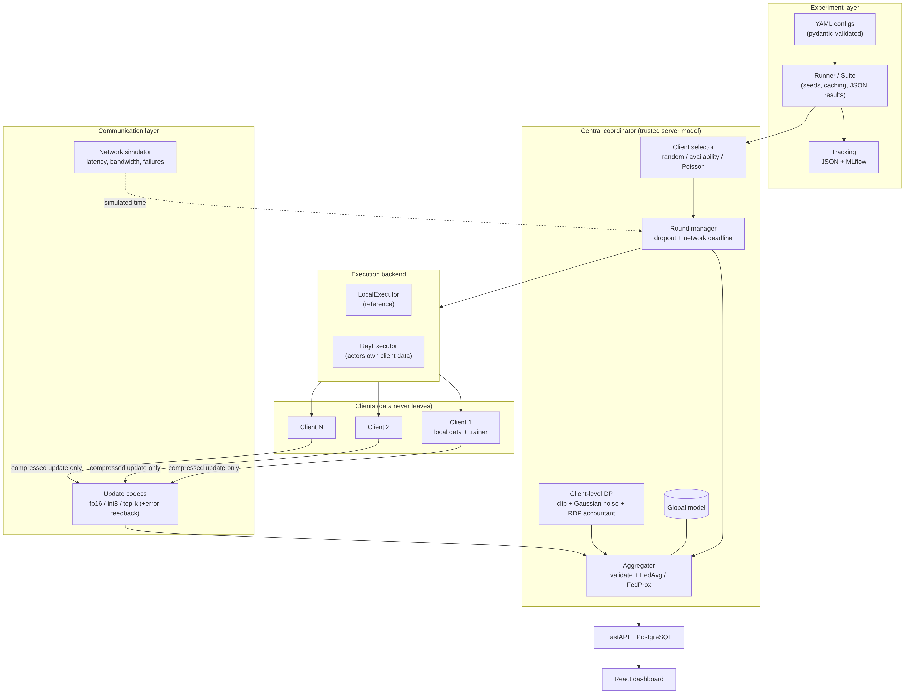

*Figure 1 – System architecture. An experiment layer (YAML → runner → tracking) drives a coordinator that selects clients and uses an execution backend (in-process or Ray). The coordinator receives only serialized model updates, which are validated, optionally clipped/noised for DP, and aggregated.*

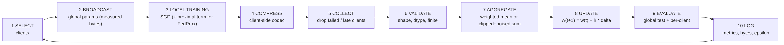

*Figure 2 – One federated round. Dropped, failed or late clients are excluded; they are never replaced by zero updates and aggregation weights are renormalised over survivors.*

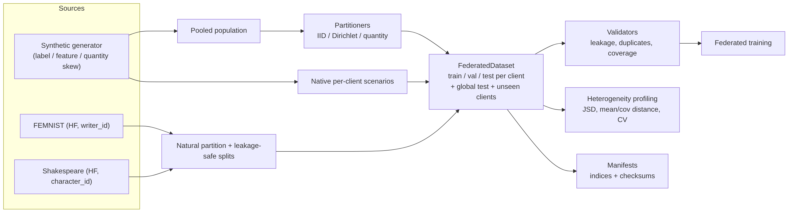

*Figure 3 – Data flow from generators, partitioners and natural loaders into one validated `FederatedDataset` container.*

Module-level details are in `docs/architecture/README.md`.

## 6. Dataset and data partitioning

**Synthetic federated tabular** (binary, 24 features, 50 clients). Each client draws labels with its own prevalence, features from a client-specific Gaussian (shifted mean, scaled covariance) and labels from a client-specific logistic model; heterogeneity sources are separate switches (label, feature, quantity). Two modes are used: *native* (per-client generator scenarios) and *pooled* (one population of 30 000 samples partitioned by the IID, Dirichlet(α) or quantity-skew partitioners). Splits are 70/15/15 per client, and an independent **global test set** is drawn from the population. Heterogeneity is *measured*, not assumed:

| Dataset | Mean pairwise label JSD | Feature-mean distance | Feature-cov. distance | Sample-count CV |
|---|---|---|---|---|
| scenario: iid | 0.0009 | 0.33 | 1.62 | 0.00 |
| scenario: label_skew | 0.274 | 0.33 | 1.62 | 0.00 |
| scenario: feature_skew | 0.0010 | 7.09 | 4.90 | 0.00 |
| scenario: quantity_skew | 0.0015 | 0.40 | 2.02 | 0.35 |
| scenario: combined_non_iid | 0.266 | 7.21 | 5.26 | 0.32 |
| partition: Dirichlet α = 10 | 0.0125 | 0.38 | 1.71 | 0.23 |
| partition: Dirichlet α = 1 | 0.154 | 0.70 | 2.11 | 0.72 |
| partition: Dirichlet α = 0.5 | 0.255 | 0.86 | 2.45 | 0.94 |
| partition: Dirichlet α = 0.1 | 0.406 | 1.71 | 7.47 | 1.73 |

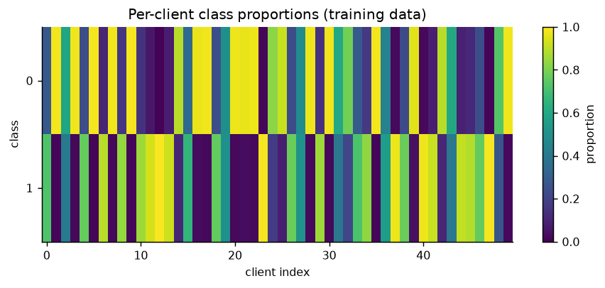

*Figure 4 – Class proportion of every client in the `label_skew` scenario. Strong column-to-column variation confirms that clients really have different class priors.*

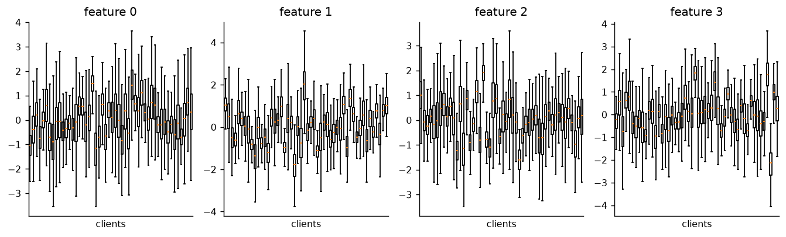

*Figure 5 – Distribution of four features per client in the `feature_skew` scenario. Shifts between boxes show covariate skew.*

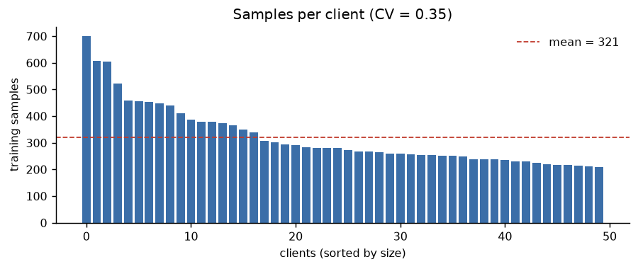

*Figure 6 – Training-set size per client under quantity skew (CV = 0.35).*

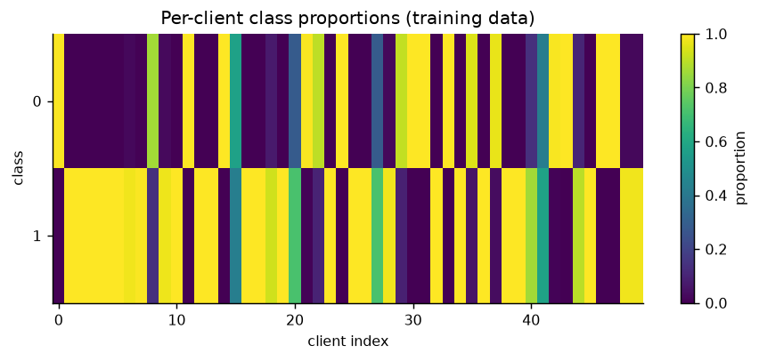

*Figure 7 – Dirichlet(α = 0.1) partition: most clients hold almost one class.*

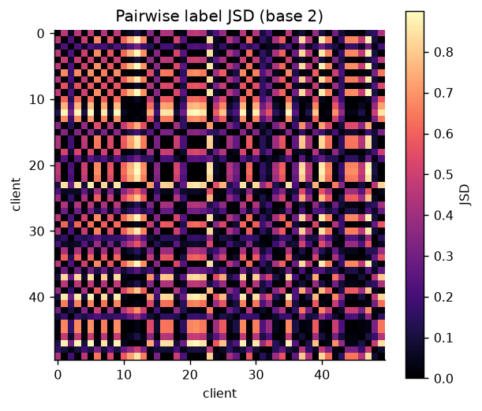

*Figure 8 – Pairwise Jensen–Shannon divergence between client label distributions in the combined scenario; bright blocks mark groups with very different label mixes.*

Data-quality and leakage checks (missing values, duplicates, invalid labels, ranges, empty partitions, train/val/test overlap, global-test leakage) are in `reports/tables/data_quality_report.json`; all scenarios pass. Dataset provenance is in `docs/dataset-cards/`.

**FEMNIST / Shakespeare.** FEMNIST is partitioned by `writer_id` with held-out *unseen writers*; Shakespeare is partitioned by `character_id` with contiguous, gap-separated splits to avoid leakage between overlapping 80-character windows. Both are covered by loader tests on fixtures only (see the scope statement).

## 7. Methodology

Protocol, data-generating process, DP design and statistics are specified in `docs/methodology/README.md`. Key points: hyper-parameters (local learning rate 0.1, FedProx μ = 1) were chosen on **validation** accuracy in pilots on seeds disjoint from the final seeds (`PILOT-LR`, `PILOT-MU`), and test metrics are reported once at the final round. Defaults: MLP (24→64→32→2), 40 rounds, participation 0.5, 2 local epochs, batch 64, SGD. Centralized reference on the same population and test set: logistic regression 0.8697 ± 0.0083, MLP 0.8581 ± 0.0072 (5 seeds).

## 8. Federated optimization algorithms

FedAvg aggregates client deltas with weights n_k / Σn_j over *valid returned* updates; the delta form is asserted equal to the parameter-averaging form. FedProx minimises L(w) + (μ/2)‖w − w_t‖² locally; with μ = 0 local training is bit-identical to FedAvg (unit-tested). Selection policies: random with participation rate, availability-based, Poisson (required by the DP accountant) and full participation.

## 9. Privacy-preserving mechanisms

Threat model: **central DP with a trusted server**; privacy unit: **one client** (add/remove adjacency); mechanism: Poisson client sampling with rate q, L2 clipping to C, Gaussian noise N(0, σ²C²I) on the sum, division by the fixed expectation qK; accountant: own RDP implementation for the sampled Gaussian mechanism with the Balle et al. conversion, cross-checked against Opacus' RDP analysis in a unit test. δ = 1e-5. This is *not* record-level DP and does not protect against an untrusted server (local DP or secure aggregation would be needed). For target-ε experiments σ is found by bisection on the accountant; ε is never assigned by hand.

## 10. Communication optimization

Codecs: float32, float16, symmetric int8, top-k sparsification (index+value payload) with optional error feedback (EF). Reported bytes are the length of the **real serialized payload** including headers. The network simulator draws heterogeneous latency, bandwidth and compute per client and reports *simulated* time separately from *wall-clock* time.

## 11. Experimental setup

Independent seeds (each seed regenerates data, partition and initialisation): 5 per condition, 8 for EXP-02. Statistics: mean ± sample SD, 95 % Student-t CI, paired t-test (same seed ⇒ same data and initial weights) with Wilcoxon as a check, Cohen's d_z, Holm correction within each family. With n = 5 the two-sided Wilcoxon test cannot go below p = 0.0625, so it is reported only as a sanity check.

## 12. Results and statistical analysis

### 12.1 RQ1 – effect of non-IID data

| Partition (pooled population, FedAvg) | n | Test acc. | Worst-client acc. |
|---|---|---|---|
| IID | 5 | 0.8668 ± 0.0099 | 0.7867 ± 0.0183 |
| Dirichlet(0.5) | 5 | 0.8604 ± 0.0091 | 0.5636 ± 0.1022 |

Paired difference (IID − Dirichlet 0.5): +0.0065 (95 % CI −0.0010…0.0140, d_z = 1.07, p = 0.075). The mean-accuracy gap is **not statistically significant at n = 5**, but the worst-client accuracy collapses, so averaged accuracy hides a fairness problem.

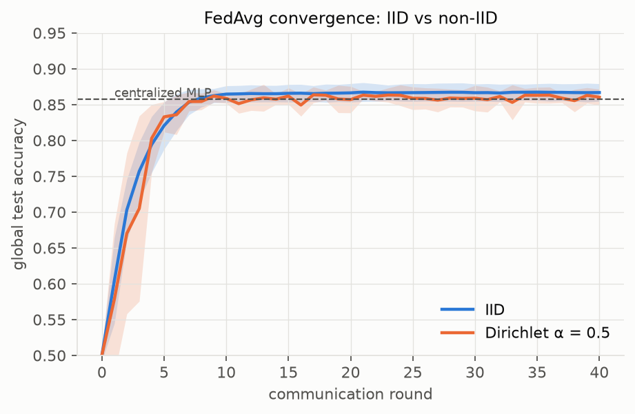

*Figure 9 – Global test accuracy per round for IID vs Dirichlet(0.5) (mean and 95 % CI over seeds). The dashed line is the centralized MLP.*

| Native scenario (FedAvg) | n | Test acc. | Worst-client acc. | Paired Δ vs IID (Holm p) |
|---|---|---|---|---|
| iid | 5 | 0.8689 ± 0.0007 | 0.7918 | – |
| label_skew | 5 | 0.6593 ± 0.0219 | 0.4082 | −0.210 (p = 1e-4) |
| feature_skew | 5 | 0.7492 ± 0.0068 | 0.4639 | −0.120 (p < 1e-4) |
| quantity_skew | 5 | 0.8684 ± 0.0031 | 0.7488 | −0.0005 (p = 0.75) |
| combined_non_iid | 5 | 0.6506 ± 0.0256 | 0.0717 | −0.218 (p = 1e-4) |

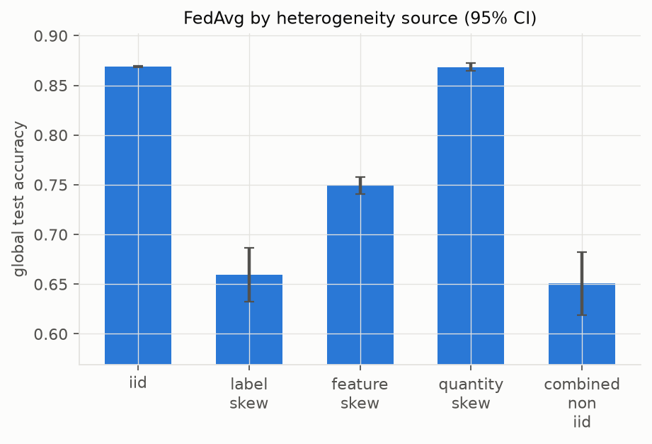

*Figure 10 – Final test accuracy for each isolated heterogeneity source. Label and feature skew are damaging; quantity skew is not.*

*Caveat:* each native scenario is its own data-generating process (label skew here recalibrates the client intercept and so changes P(y|x), unlike a Dirichlet partition of a shared population, which only changes P(y)). The contrast is between scenarios, not a single controlled treatment. That prior-shift partitions hurt much less than conditional-shift scenarios is a plausible explanation for the small Dirichlet gap, but we did not test it directly.

Dirichlet α sweep (FedAvg, 8 seeds): test accuracy 0.8672 (α = 10), 0.8627 (1), 0.8602 (0.5), 0.8212 ± 0.0526 (0.1), with worst-client accuracy 0.778 → 0.122. Strong heterogeneity (α = 0.1) increases run-to-run variance more than it moves the mean.

### 12.2 RQ2 – FedAvg vs FedProx

| α | FedAvg acc. | FedProx (μ = 1) acc. | Δ acc. (Holm p) | Δ curve-AUC (Holm p) |
|---|---|---|---|---|
| 10 | 0.8672 | 0.8662 | −0.0009 (0.32) | −0.0164 (1e-4) |
| 1 | 0.8627 | 0.8641 | +0.0013 (0.32) | −0.0191 (2e-4) |
| 0.5 | 0.8602 | 0.8628 | +0.0025 (0.18) | −0.0180 (1e-4) |
| 0.1 | 0.8212 | 0.8382 | +0.0170 (0.13) | −0.0090 (0.076) |

(n = 8 seeds, paired.) FedProx's final-accuracy differences are **not significant after correction**; the largest, at α = 0.1 (+1.7 points, raw p = 0.034), is suggestive only. Convergence speed (area under the accuracy curve) is significantly *worse* for FedProx for α ≥ 0.5 over the 40-round budget, and rounds to 0.80 validation accuracy roughly double (≈ 4–6 → 8–11). Worst-client accuracy did not improve.

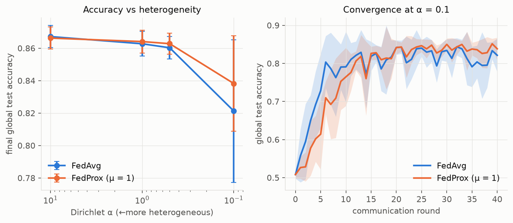

*Figure 11 – Left: final accuracy for four α. Right: convergence at α = 0.1. FedProx trades speed for a possibly lower final variance.*

μ sensitivity (5 seeds): μ ≤ 0.1 ≈ FedAvg; μ = 1–3 gives +0.0–1.2 points at α = 0.1 but slower AUC; μ = 10 hurts badly (0.749 at α = 0.1).

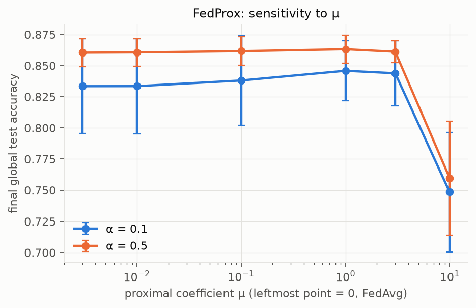

*Figure 12 – Final accuracy vs μ. Large μ over-constrains local training.*

**Conclusion RQ2:** in this benchmark FedProx offers no statistically robust accuracy benefit and slows early convergence; a modest benefit at extreme heterogeneity cannot be excluded (low power).

### 12.3 RQ5 – participation and dropout

| Participation | FedAvg acc. | Rounds→0.80 | Client updates | Total MB |
|---|---|---|---|---|
| 0.1 | 0.8282 ± 0.0414 | 4.8 | 200 | 6.0 |
| 0.25 | 0.8396 ± 0.0219 | 4.6 | 480 | 14.5 |
| 0.5 | 0.8604 ± 0.0091 | 4.8 | 1000 | 30.2 |
| 0.75 | 0.8615 ± 0.0073 | 4.0 | 1520 | 45.8 |
| 1.0 | 0.8642 ± 0.0078 | 3.8 | 2000 | 60.3 |

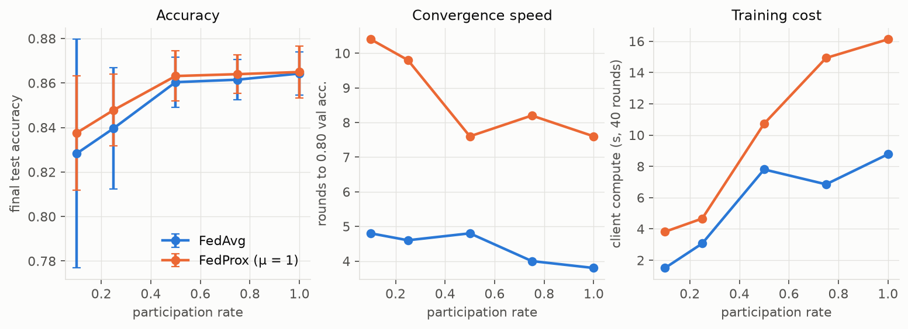

*Figure 13 – Participation rate vs accuracy, rounds-to-target and compute (α = 0.5). Returns diminish above 0.5 while cost grows linearly.*

| Dropout (participation 0.5) | FedAvg acc. | Updates received |
|---|---|---|
| 0.0 | 0.8604 ± 0.0091 | 1000 |
| 0.1 | 0.8607 ± 0.0087 | 894 |
| 0.3 | 0.8578 ± 0.0071 | 694 |
| 0.5 | 0.8590 ± 0.0084 | 486 |
| 0.7 | 0.8245 ± 0.0319 | 290 |

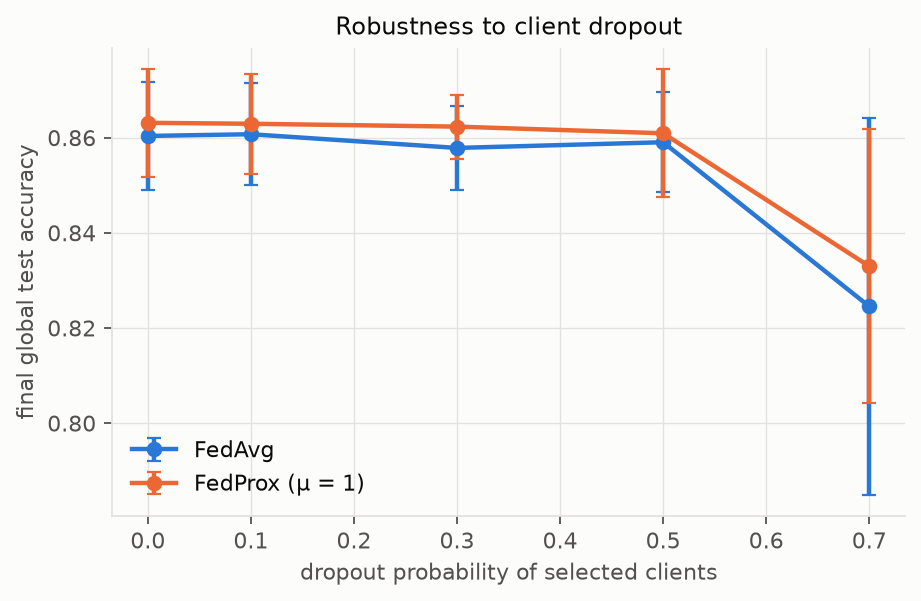

*Figure 14 – Accuracy vs random dropout. Because dropped clients are excluded (not zero-filled) and weights are renormalised, accuracy is stable until most updates are lost.*

Random dropout here is independent of client data; correlated dropout (e.g. whole classes disappearing) was not studied.

### 12.4 RQ3 – differential privacy

Client-level central DP, logistic regression, 50 clients, q = 0.5, 40 rounds, δ = 1e-5:

| Variant | σ | ε | Test acc. |
|---|---|---|---|
| no DP | – | ∞ | 0.8680 ± 0.0092 |
| clip only | 0 | ∞ | 0.8699 ± 0.0091 |
| ε = 50 | 0.698 | 49.9 | 0.8658 ± 0.0074 |
| ε = 20 | 1.154 | 20.0 | 0.8608 ± 0.0093 |
| ε = 10 | 1.864 | 10.0 | 0.8493 ± 0.0078 |
| ε = 5 | 3.195 | 5.0 | 0.8309 ± 0.0102 |
| ε = 2 | 6.970 | 2.0 | 0.7958 ± 0.0185 |

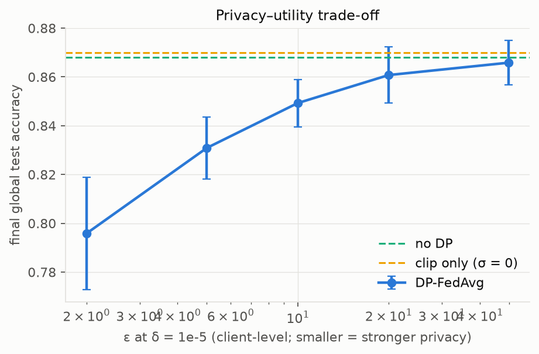

*Figure 15 – Accuracy vs the accountant's ε. Utility degrades smoothly; ε = 2 costs ≈ 7 points.*

Clipping alone does not hurt. In the C × σ grid (EXP-05) the best cells use small clipping norms (C = 0.1–0.5) because noise scales with C, while C = 2 with σ = 2 is worst (0.8218).

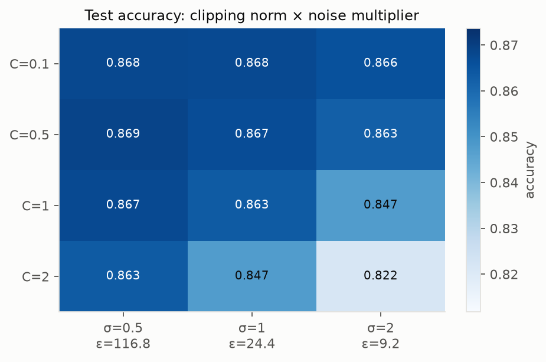

*Figure 16 – Accuracy for each (C, σ). Column labels give the ε the accountant computes for σ (it does not depend on C).*

More clients help at fixed ε = 5: 200 clients reach 0.8515 vs 0.8309 with 50 (unpaired comparison of different datasets; n = 5 each). Under DP + heterogeneity at ε = 10 (EXP-08), FedProx (μ = 1) is *worse* than FedAvg by 1.2–2.2 points on all partitions (Holm p = 0.03, paired n = 5), so the FedProx recommendation from 12.2 does not carry over to DP. We did not investigate the mechanism.

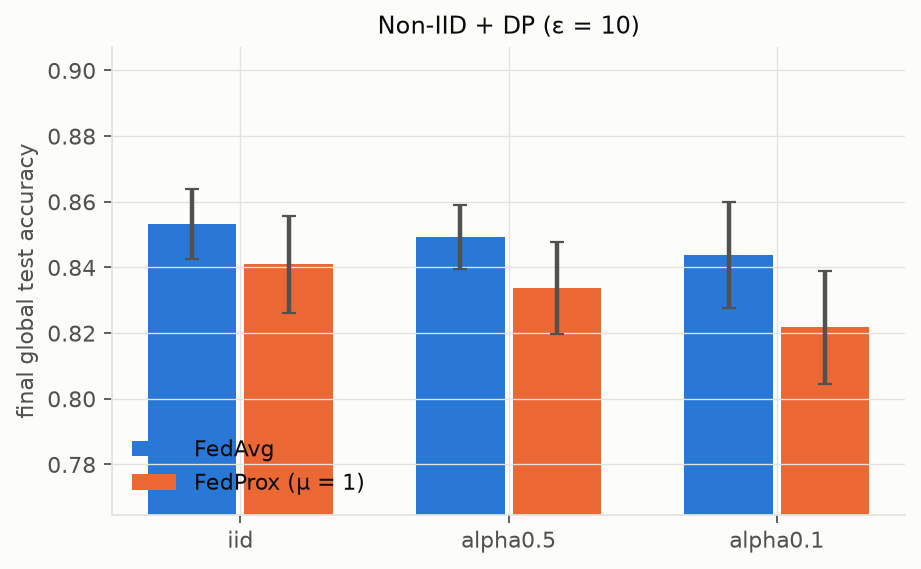

*Figure 17 – Combined heterogeneity and DP (ε = 10).*

Caveats: with only 50 clients, ε ≤ 10 at client level is already costly; δ = 1e-5 is not smaller than 1/K, which a strict deployment would require; the server is trusted.

### 12.5 RQ4 – communication compression

| Codec | Bytes / update | Uplink ratio | Total MB (up+down) | Test acc. |
|---|---|---|---|---|
| float32 | 15 009 | 1.00 | 30.15 | 0.8604 ± 0.0091 |
| float16 | 7 517 | 2.00 | 22.66 | 0.8606 ± 0.0090 |
| int8 | 4 028 | 3.73 | 19.17 | 0.8604 ± 0.0091 |
| top-10 % | 3 067 | 4.89 | 18.21 | 0.8622 ± 0.0078 |
| top-10 % + EF | 3 067 | 4.89 | 18.21 | 0.8605 ± 0.0083 |
| top-1 % | 363 | 41.35 | 15.50 | 0.8645 ± 0.0084 |
| top-1 % + EF | 363 | 41.35 | 15.50 | 0.8629 ± 0.0078 |
| int8 up + 16-bit down | 4 028 | 3.73 | 11.68 | 0.8605 ± 0.0091 |

No codec differs from float32 in final accuracy (all paired Holm p ≥ 0.49; the small positive differences are within noise and should not be read as compression helping). The cost shows up in convergence speed: curve-AUC falls from 0.844 to 0.822 for top-1 %. Because downlink stays float32, total traffic shrinks only 1.9× for top-1 % although uplink shrinks 41×; compressing the downlink as well (int8 up + 16-bit down) gives 2.6×.

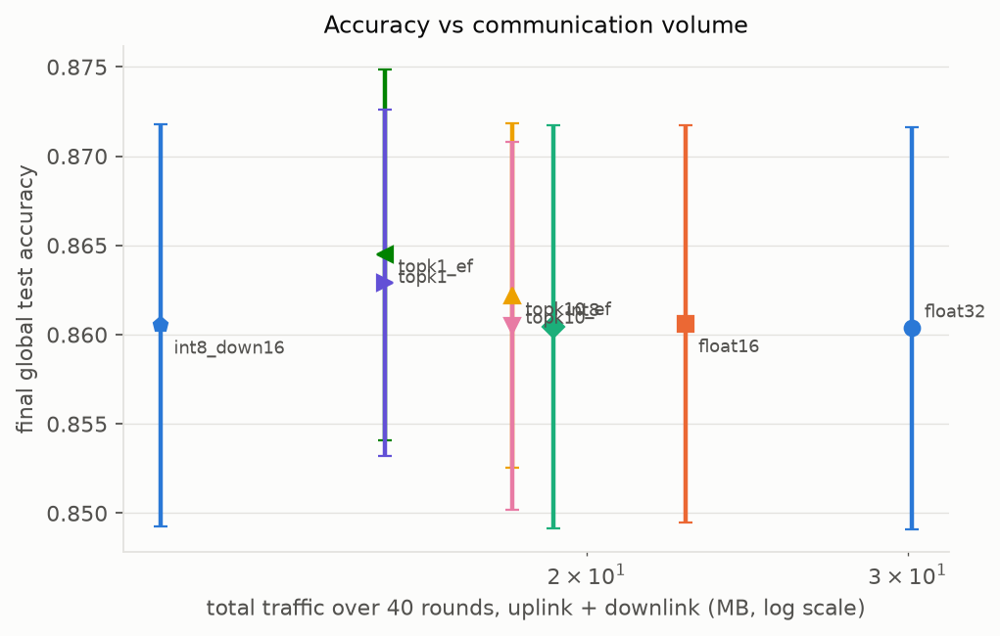

*Figure 18 – Accuracy vs total measured traffic. Points further left send fewer bytes.*

Slow-network study (EXP-09, 0.5 Mbit/s heterogeneous links, 5 % communication failures, round deadline): with a 0.8 s deadline the int8 uplink delivered 441 updates vs 318 for float32 (mean accuracy 0.845 vs 0.826, n = 5, not tested for significance). The simulated training time (60–190 s) is a model quantity and differs from the ≈ 8 s of real wall-clock time.

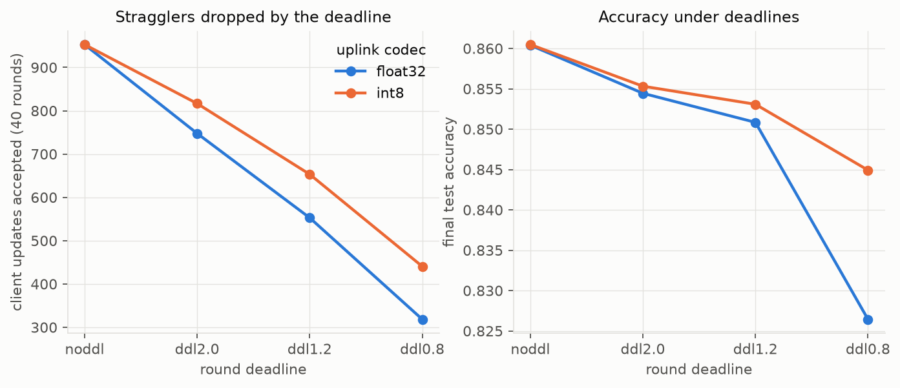

*Figure 19 – Accepted updates and accuracy vs round deadline for float32 and int8 uplinks (simulated network).*

## 13. Ablation studies

* **FedProx μ** (EXP-02B), **clip × σ** (EXP-05), **number of clients at fixed ε** (EXP-05B), **error feedback on/off** (EXP-06) and **downlink compression** (EXP-06) are ablations in the tables above.
* Not ablated: local epochs, model size, server learning rate, server-side momentum.

## 14. Limitations and threats to validity

1. **Single synthetic benchmark.** Gaussian class-conditionals favour near-linear models; conclusions (especially "FedProx does not help" and "compression is free") may not transfer to CNN/GRU on FEMNIST/Shakespeare. Real-dataset runs are pending network access.
2. **Power.** n = 5–8 seeds detect only large effects; non-significant ≠ no effect (e.g. IID vs Dirichlet 0.5, p = 0.075).
3. **Tuning scope.** Learning rate and μ were tuned once at one heterogeneity level, on validation data, with 4 pilot seeds; μ = 1 was used although μ = 3 scored marginally higher in the pilot (0.819 vs 0.811).
4. **DP.** Central DP with trusted server; 50 clients make strong client-level guarantees costly; δ = 1e-5 > 1/K; accountant covers the Gaussian-sampled mechanism only; integer RDP orders give slightly looser ε than fractional orders.
5. **Simulation.** All clients run in one machine; the network is modelled; wall-clock time is not a deployment latency.
6. **Dropout model** is random and independent of data.
7. **Comparisons across generators** (native scenarios) mix several differences at once.
8. **Environment.** Results were produced with Python 3.13, PyTorch 2.15 (CPU); CI also covers Python 3.12.

## 15. Discussion

Heterogeneity matters most when it changes the *conditional* relationship between features and labels (here, label-skew via client intercepts, and feature shift), much less when it only changes class counts or data volume. Average accuracy underestimates the damage: worst-client accuracy is the better alarm. Proximal regularisation did not repay its slower convergence here, and its interaction with DP was negative. DP utility is dominated by noise relative to the aggregate, so more clients and smaller clipping norms are the cheapest levers. Quantization is effectively free; aggressive sparsification trades speed for bytes, and the downlink should not be forgotten.

## 16. Conclusion and future work

The platform answers all five research questions with reproducible, statistically analysed evidence on a controllable benchmark, and is structured so the same configs run on FEMNIST and Shakespeare. Future work: run the FEMNIST/Shakespeare experiments, add secure aggregation / local DP, correlated dropout, server optimizers (FedAdam), personalization, and larger seed counts for the FedProx question.

## 17. References

* McMahan et al. (2017). Communication-Efficient Learning of Deep Networks from Decentralized Data. AISTATS.
* Li et al. (2020). Federated Optimization in Heterogeneous Networks (FedProx). MLSys.
* Hsu, Qi, Brown (2019). Measuring the Effects of Non-Identical Data Distribution for Federated Visual Classification.
* McMahan, Ramage, Talwar, Zhang (2018). Learning Differentially Private Recurrent Language Models. ICLR.
* Mironov (2017). Rényi Differential Privacy. CSF. Mironov, Talwar, Zhang (2019). Rényi Differential Privacy of the Sampled Gaussian Mechanism. arXiv:1908.10530.
* Balle, Barthe, Gaboardi, Hsu, Sato (2020). Hypothesis Testing Interpretations and Rényi Differential Privacy. AISTATS.
* Caldas et al. (2018). LEAF: A Benchmark for Federated Settings. arXiv:1812.01097.
* Stich, Cordonnier, Jaggi (2018). Sparsified SGD with Memory. NeurIPS. Alistarh et al. (2017). QSGD. NeurIPS.
* Yousefpour et al. (2021). Opacus: User-Friendly Differential Privacy Library in PyTorch. Moritz et al. (2018). Ray. Zaharia et al. (2018). MLflow.

## 18. Appendices

* **A. Reproduction.** `python scripts/run_experiment.py --suite configs/experiments/<suite>.yaml` (resumable), then `python scripts/generate_report.py`. Each result JSON stores the full config, config hash, environment and git revision.
* **B. Full tables.** `reports/tables/results_summary.md` and CSVs in `reports/tables/`.
* **C. Validation.** 125 automated tests (unit, integration, system, performance, Ray) cover invariants such as single-client FedAvg = that update, FedProx(μ = 0) = FedAvg, no zero-filling of absent clients, accountant = Opacus, local ≡ Ray executor.
